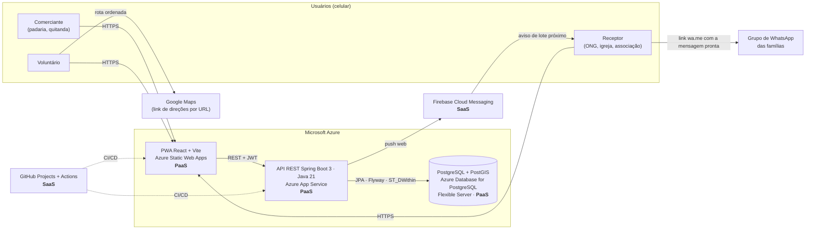
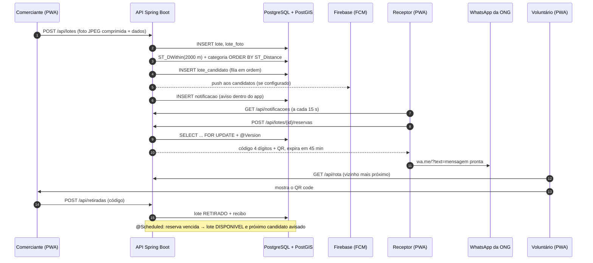

# Arquitetura – Rota Solidária

Plataforma de bairro que liga pequenos comércios com sobra de alimento a ONGs, igrejas e associações num raio de 2 km, com retirada em menos de uma hora.

## Visão geral

- **PWA (front-end)**: React + Vite, mobile-first e instalável (manifest + service worker do `vite-plugin-pwa`). Hospedado no **Azure Static Web Apps**, que entrega os arquivos estáticos por CDN com HTTPS.
- **API (back-end)**: Java 21 + Spring Boot 3 (Spring Web, Spring Data JPA, Bean Validation, Spring Security com JWT, `@Scheduled`), documentada com springdoc-openapi (Swagger UI em `/swagger-ui.html`). Hospedada no **Azure App Service** (Linux, Java SE).
- **Banco**: PostgreSQL com **PostGIS** (`geography(Point, 4326)` e índices GIST), migrações versionadas com **Flyway**. Destino: **Azure Database for PostgreSQL – Flexible Server**.
- **Notificações**: **Firebase Cloud Messaging** (push web). Sem credenciais, nada quebra: o aviso é gravado no banco e aparece dentro do app (polling leve a cada 15 s).
- **Famílias**: não usam o sistema. A ONG repassa o aviso pelo grupo de WhatsApp que já tem, com um link `https://wa.me/?text=...` (sem API paga). Nenhum dado de família é armazenado.
- **Rotas**: sem API paga. A rota é calculada na API (vizinho mais próximo) e aberta no Google Maps por URL (`https://www.google.com/maps/dir/?api=1&origin=...&destination=...&waypoints=...`), sem chave.
- **Gestão**: GitHub Projects (quadro montado a partir do [BACKLOG.md](../BACKLOG.md)) e GitHub Actions para o deploy.

## Fluxo principal (sequência)

## Por que PaaS e não IaaS

Escolhemos serviços gerenciados (PaaS) em vez de máquinas virtuais (IaaS). Com Static Web Apps, App Service e PostgreSQL Flexible Server **não há servidor para administrar**: a Azure cuida do sistema operacional, dos patches de segurança, do runtime Java e do certificado HTTPS, e a equipe de três pessoas gasta o tempo no produto, não em `apt upgrade`. **Backup e escala são gerenciados**: o PostgreSQL Flexible Server faz backup automático com restauração para um ponto no tempo, e o App Service escala verticalmente ou horizontalmente por configuração, sem reinstalar nada. Por fim, a solução **cabe nos créditos do Azure for Students**: o Static Web Apps tem plano gratuito, e o App Service (plano B1) e o PostgreSQL (camada Burstable B1ms) são as menores camadas pagas, suficientes para um piloto de bairro. Uma VM equivalente exigiria pagar e manter servidor, banco, backup e proxy reverso por conta própria.

## Decisões técnicas

| Tema | Decisão | Motivo |
|---|---|---|
| Localização | Colunas `latitude`/`longitude` mapeadas pelo JPA e coluna `localizacao geography(Point, 4326)` **gerada** pelo banco | O JPA não precisa de biblioteca espacial; o PostGIS indexa (GIST) e calcula distâncias em metros |
| Matching | Consulta nativa com `ST_DWithin` + `ST_Distance` ([docs/queries.sql](queries.sql)), fila gravada em `lote_candidato` | Rápida (índice GIST, < 500 ms) e legível para o vídeo |
| Reserva dupla | `SELECT ... FOR UPDATE` no lote + `@Version` + índice único parcial `reserva(lote_id) WHERE status='ATIVA'` | Três barreiras: aplicação, ORM e banco |
| Expiração | `@Scheduled` a cada 15 s (5 s no perfil demo) | Sem fila/broker extra; simples de explicar |
| Fotos | Comprimidas no navegador (1024 px, JPEG 0,7) e guardadas em `bytea` numa tabela separada (`lote_foto`) | Sem serviço de storage; listas não carregam os bytes |
| Push | FCM opcional; aviso sempre gravado em `notificacao` e entregue por polling | O sistema não depende de credencial externa para funcionar |
| Autenticação | JWT HS256 assinado pelo Spring Security (resource server), senhas com BCrypt | Stateless, sem servidor de identidade extra |
